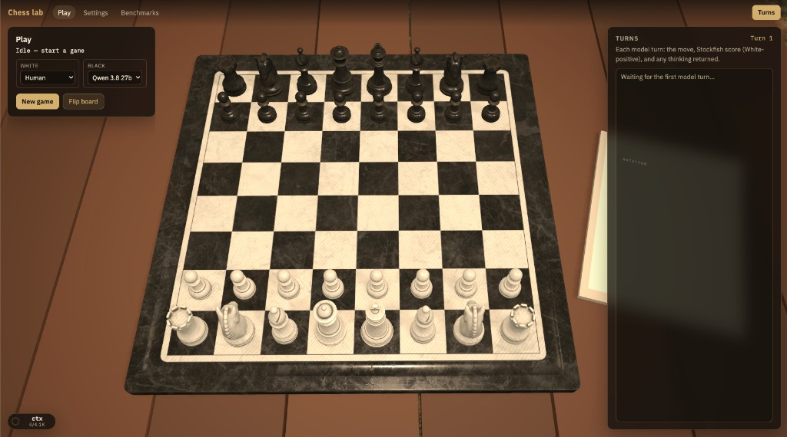

# Chess lab

A browser chess **lab**: play against a model (or leave both seats to models), log every game, and iterate the harness.

Live site (GitHub Pages): [https://higginsrob.github.io/chess/](https://higginsrob.github.io/chess/)



This is a **static** Vite app. There is no backend and **API keys are never stored**.

## What it does

- Either seat is **Human** or a **model config**. Human vs AI and AI vs AI both work.
- Two seats can use different providers and models (local vs local, local vs API, a model vs itself).
- Click a piece, then a highlighted square. No drag in v1.
- Models must reply `{"move": "Nf3"}` (SAN inside JSON). Illegal or unparseable moves **forfeit immediately** — no retries.
- FIDE-lite endings: checkmate, stalemate, threefold, 50-move, insufficient material. HTTP errors and timeouts also forfeit.
- Games are saved in IndexedDB, can be downloaded as JSON or a zip, and can be committed into `public/benchmarks` for the Benchmarks page.
- Stockfish (in a Web Worker) annotates games (ACPL, inaccuracy / mistake / blunder). Live eval during play is on by default and can be turned off in Settings.

## Run locally

Node 22+.

```bash
npm install
npm test
npm run dev
```

Open `https://localhost:5173/chess/` (`base` is `/chess/` so GitHub Pages and local Vite share the same paths). The first visit shows a self-signed certificate warning — proceed so the page is a secure origin for cloud APIs.

```bash
npm run build
npm run preview
```

See [CONTRIBUTING.md](CONTRIBUTING.md) for pull-request notes.

## Deploy

Push to `main`. GitHub Actions runs tests, builds, and publishes `dist` to Pages (`404.html` is copied from `index.html` for the SPA). Pull requests run the same tests and build without deploying.

In the GitHub repo: **Settings → Pages → Source: GitHub Actions**.

The Vite `base` is `/chess/` locally. On Actions it follows the repository name so a fork named `chess-lab` deploys under `/chess-lab/`. For a custom domain, set `VITE_BASE=/` on the build step.

Local Vite is the reliable way to talk to **Ollama / LM Studio / llama.cpp / SGLang** on this machine. GitHub Pages is HTTPS; those servers are usually `http://localhost`, and Safari / Firefox are stricter about that than Chromium.

## Settings: providers, models, seats

Three layers — do not collapse them:

1. **Provider** — named endpoint (`http://localhost:11434/v1`, `http://localhost:1234/v1`, `https://api.openai.com/v1`, `https://api.anthropic.com/v1`, …), **local inference** checkbox, optional key, extra non-auth headers.
2. **Model config** — provider, model id, optional temperature / max_tokens / top_p / seed, timeout (default 120000 ms), JSON-mode toggle, extra system prompt.
3. **Seats** — White and Black independently Human or a named model config.

Persistence:

| Saved in `localStorage` | Never saved |
| --- | --- |
| Provider name, base URL, local flag, extra **non-auth** headers | **API keys** |
| Model configs (no keys) | `Authorization`, `x-api-key`, `Cookie`, and similar extra headers |
| Seat assignments, HDRI, flip board, live-eval toggle | Anything that could reconstruct a cloud token |

Keys live in memory and disappear on refresh. The Settings page says so when any cloud provider is present. See [SECURITY.md](SECURITY.md) to report a vulnerability.

### CORS (when local inference is on)

- **Ollama:** `OLLAMA_ORIGINS=https://higginsrob.github.io,https://localhost:5173`
- **LM Studio:** enable CORS in server settings
- **llama.cpp:** `--cors`
- **SGLang / vLLM:** OpenAI-compat on `/v1`; CORS still depends on launch flags

**Anthropic** (`https://api.anthropic.com/v1`) does not send CORS headers unless the request includes `anthropic-dangerous-direct-browser-access: true`. The app adds that header, plus `x-api-key` and `anthropic-version`, on every Anthropic request (including GitHub Pages). Paste a key from the [Anthropic console](https://console.anthropic.com/settings/keys) (RAM-only). Anthropic’s OpenAI-compat layer ignores `response_format`; the harness prompt still asks for JSON.

**Ollama Cloud** (`https://ollama.com/v1`) does not send CORS headers, so the browser cannot call it from GitHub Pages. Two working paths:

1. **Local Vite** (`npm run dev` / `npm run preview`): the dev server proxies `https://ollama.com`. Create a provider with base URL `https://ollama.com/v1`, leave local inference off, and paste an [API key](https://ollama.com/settings/keys) (still RAM-only).
2. **Local Ollama as a gateway** (also works from Pages in Chromium): `ollama signin`, `ollama pull gpt-oss:120b-cloud` (or another `:cloud` model), keep the provider at `http://localhost:11434/v1`, and set `OLLAMA_ORIGINS` as above.

Test connection hits `GET {baseUrl}/models`, then a tiny `chat/completions` ping if that 404s.

## Harness

Each turn is `POST {baseUrl}/chat/completions` (or Ollama native `POST /api/chat`) with streaming so reasoning can show live:

- color to move, FEN, PGN, **full legal-move list (SAN)**, JSON contract `{"move": "<SAN>"}`
- the model config’s extra system prompt appended after that

Parse: strip markdown fences, take the first JSON object, read `move`, apply as SAN. No second request.

Primary KPI: **illegal-move forfeit rate**.

## Benchmarks

1. Run a game or a sequential batch (optional color swap).
2. Download JSON / zip from Play, or export from Benchmarks.
3. Commit into `public/benchmarks/*.json` and list the file in `public/benchmarks/manifest.json`.
4. Iterate prompt, JSON-mode, temperature, timeout, parse rules; re-run and compare forfeit rate, ACPL, and W/D/L.

Elo / Glicko is out of v1.

## 3D scene

The play view loads the Poly Haven [Chess Set](https://polyhaven.com/a/chess_set) (2K glTF, separate meshes per piece) on a picnic table that is larger than the board. The concrete pad under the table uses the tiled [Worn Concrete Floor](https://polyhaven.com/a/worn_concrete_floor) maps. HDRI ingest (Medieval Cafe vs Bethnal Green Entrance) is still a later pass; placeholder lighting stands in for the switcher.

Do not commit 8K packs. Re-download 2K assets with `scripts/ingest-polyhaven.sh`.

## Stockfish

The worker loads `{base}/stockfish/stockfish.js`. If that file is missing, games still run; ACPL is skipped.

Centipawn-loss buckets (documented in `src/stockfish/thresholds.ts`):

- inaccuracy ≥ 50
- mistake ≥ 100
- blunder ≥ 300

That worker is **GPL-3.0** (see `public/stockfish/README.md`). The rest of this repo is MIT.

## License

Code is **MIT**. IBM Plex (UI type) is **SIL Open Font License**. Poly Haven assets are **CC0**; credit the authors when those packs are ingested:

| Role | Asset | Author |
| --- | --- | --- |
| Chess board + pieces | [Chess Set](https://polyhaven.com/a/chess_set) | Riley Queen |
| Table | [Wooden Picnic Table](https://polyhaven.com/a/wooden_picnic_table) | Ulan Cabanilla |
| Notation prop | [Binder Notebook](https://polyhaven.com/a/binder_notebook) | DaDrood |
| Default environment | [Medieval Cafe](https://polyhaven.com/a/medieval_cafe) | Dimitrios Savva (photo), Jarod Guest (process) |
| Alternate environment | [Bethnal Green Entrance](https://polyhaven.com/a/bethnal_green_entrance) | Andreas Mischok |
| Pad | [Worn Concrete Floor](https://polyhaven.com/a/worn_concrete_floor), [Concrete Floor 02](https://polyhaven.com/a/concrete_floor_02) | Poly Haven listings |

`project.plan.md` is the original design notes; the running app and this README are the source of truth when they differ.
