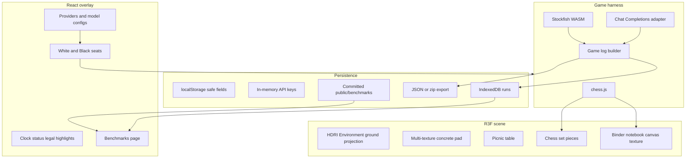

# Chess lab — project plan

Source of truth for an MIT-licensed, browser-based chess **lab**: a three.js scene, an OpenAI-compatible agent harness, and a static benchmark corpus. The live app is a GitHub Pages site with no backend. This document records locked design decisions. It is not an implementation.

Repo: `higginsrob/chess`. Intended site: `https://higginsrob.github.io/chess/`.

---

## 1. Purpose

Build a chess environment we can play in and **measure**.

- A person can play White or Black against a model, or leave both seats to models.
- Two seats can use different **providers** and **model configurations** (local vs local, local vs API, same model vs itself).
- Every game (and every batch of games) produces a structured **log**. Logs stay in the browser, can be downloaded, and can be committed into the repo so a **Benchmarks** page can aggregate them.
- Those packages are the **feedback loop**: hand a batch of runs back to Cursor and iterate the harness (prompt, JSON contract, defaults, parse rules) to raise legal-move rate and chess quality.

The site is static. There is no safe place to store API tokens. That constraint is visible in the UI and in persistence rules below.

---

## 2. Locked product decisions

| Topic | Decision |
| --- | --- |
| Human play in v1 | Yes. Either seat is **Human** or a **model config**. Human vs AI and AI vs AI both ship in v1. |
| Illegal / unparseable move | **Immediate forfeit**. No retries, no random fallback. |
| LLM output | Strict JSON: `{"move": "Nf3"}` (SAN inside JSON). |
| Prompt contents | Color to move, FEN, PGN, **full legal-move list (SAN)**, output contract. Optional extra system prompt per model config. |
| Stockfish | In-browser WASM. User toggle: live eval during play vs **post-game only** (default **post-game**). |
| Batch | Yes. N sequential games, optional color swap each game, one combined export. 3D stays in sync. No concurrent headless games in v1. |
| Human input | Click piece, then click target square. Legal squares highlighted. No drag in v1. |
| Draws | FIDE-lite: stalemate, threefold repetition, 50-move, insufficient material. HTTP/timeout also forfeits. |
| License | **MIT** for code. Poly Haven assets are **CC0**; credit authors in README. |
| API dialect | OpenAI **Chat Completions** `POST {baseUrl}/chat/completions`. Non-streaming in v1. |

---

## 3. Stack (locked)

- **Vite + TypeScript + React** for the overlay (settings, HUD, benchmarks).
- **@react-three/fiber** + **@react-three/drei** for the scene.
- **three.js** via R3F. **OrbitControls** for orbit/pan/zoom. A **Flip board** control for the Black seat.
- **chess.js** for rules, SAN, FEN, PGN, and draw detection.
- **Stockfish WASM** for move quality (ACPL, inaccuracy / mistake / blunder).
- **idb** (or equivalent) for IndexedDB.
- GitHub Actions deploy to **GitHub Pages**. Vite `base: '/chess/'`. SPA fallback: copy `index.html` → `404.html`.

Routes:

- `/` — Play
- `/settings` — Providers, model configs, seats, scene (or a settings panel reachable from Play)
- `/benchmarks` — Local IndexedDB runs plus committed corpus

---

## 4. Architecture



### 4.1 Future app layout

```
chess/
  project.plan.md          ← this file
  README.md
  LICENSE                  ← MIT
  package.json
  vite.config.ts           ← base: '/chess/'
  index.html
  .github/workflows/pages.yml
  public/
    assets/                ← compressed 2K glTF, 2K textures, 2K–4K HDRIs
    benchmarks/            ← committed corpus JSON + manifest
    404.html               ← copy of index.html for SPA
  src/
    main.tsx
    App.tsx
    scene/                 ← R3F canvas, environment, pad, table, board, notebook
    harness/               ← chess.js game loop, SAN parse, termination, batch runner
    providers/             ← Chat Completions adapter, JSON-mode mapping, timeouts
    settings/              ← providers, model configs, seats, persistence
    benchmarks/            ← IndexedDB, export, metrics, Benchmarks page
    stockfish/             ← WASM worker wrapper, eval thresholds
```

---

## 5. Providers, model configs, seats

Three layers. Do not collapse them into a single “API key + model” form.

### 5.1 Provider (named endpoint)

- `name`
- `baseUrl` — OpenAI-compatible root, e.g. `http://localhost:11434/v1`, `http://localhost:1234/v1`, `https://api.openai.com/v1`
- **`localInference` checkbox**
- API key (password field; never written to disk)
- Optional extra **non-auth** headers
- JSON-mode mapping is the adapter’s job:
  - OpenAI: `response_format: { "type": "json_object" }`
  - Ollama OpenAI-compat / some local servers: `format: "json"` (or equivalent)
  - Send JSON-mode only when the model config toggle is on

### 5.2 Model configuration (uses one provider)

- `name`, `providerId`, `model` id
- `temperature`, `max_tokens`, `top_p`, `seed` — send a field only if the UI enables it
- `timeoutMs` — default **120000**; on timeout that side **forfeits**
- `response_format` / JSON-mode toggle
- Optional extra **system prompt** appended after the harness prompt

### 5.3 Seats

White and Black independently = **Human** or a **model config**.

This covers Human vs AI, AI vs itself, local vs local, and local vs cloud.

---

## 6. Persistence (GitHub Pages)

The site cannot store secrets. Be explicit in the UI.

| Persists (`localStorage`) | Never persists |
| --- | --- |
| Provider name, base URL, `localInference`, extra non-auth headers | **API keys** |
| All model configs (no keys) | Anything that could reconstruct a cloud token |
| Seat assignments, scene prefs (HDRI, flip board) | |
| Stockfish live-eval toggle | |

Keys live in **memory only** and are discarded on refresh.

When **`localInference` is on**:

- No key required.
- Settings shows CORS help (see §7).
- Copy: the endpoint URL will persist across refreshes.

When **`localInference` is off** (cloud):

- Treat as a remote API.
- Key stays in RAM.
- Banner: *“API keys are kept in memory only and are discarded when you refresh. This site is static and cannot store secrets.”*

---

## 7. CORS, mixed content, and local inference

GitHub Pages is HTTPS. Local servers are usually `http://127.0.0.1` / `http://localhost`.

- **Chromium** often allows HTTPS pages to call `http://localhost`. **Safari and Firefox** are stricter. Document this; do not pretend it always works from Pages.
- The reliable path for Ollama / LM Studio / SGLang / llama.cpp is **local Vite** (`npm run dev` / `npm run preview`).
- Never proxy keys through GitHub Actions or any third-party backend in v1.

CORS notes to show when `localInference` is checked:

- **Ollama:** `OLLAMA_ORIGINS` must include `https://higginsrob.github.io` (Pages) and `http://localhost:5173` (Vite). Example: `OLLAMA_ORIGINS=https://higginsrob.github.io,http://localhost:5173`.
- **LM Studio:** enable CORS in server settings.
- **llama.cpp:** `--cors` (and matching origin if required).
- **SGLang / vLLM:** typically already OpenAI-compat on `/v1`; CORS still depends on how the server is launched.

Test-connection button: `GET {baseUrl}/models` if it exists; otherwise a tiny `chat/completions` ping. Surface HTTP and CORS failures in plain language.

---

## 8. Agent harness (locked)

### 8.1 Request

`POST {baseUrl}/chat/completions`

Non-streaming in v1 (simpler, complete logs). Streaming is a later enhancement.

### 8.2 Prompt

The harness always sends:

- Which color the model is playing
- Current **FEN**
- Game **PGN** so far
- **Full list of legal moves in SAN**
- Output contract: JSON only, `{"move": "<SAN>"}`

The model config’s extra system prompt, if set, is **appended** after this harness prompt.

Legal moves are included on purpose (locked). That raises parse/legal-move rate. The primary harness KPI is still **illegal-move forfeit rate**; listing legal moves makes the remaining forfeits a prompt/parse problem more than a “did the model invent Nf4” problem.

### 8.3 Parse

1. Strip markdown fences.
2. Take the first JSON object in the reply.
3. Read `move` as a string.
4. Apply it as **SAN** with chess.js.

Unparseable **or** illegal → **immediate forfeit**. Robust extract is allowed; a **second request is not**.

### 8.4 Game end

- Checkmate
- Stalemate
- Threefold repetition
- 50-move rule
- Insufficient material
- Illegal or unparseable move (forfeit)
- HTTP error or timeout (forfeit)

### 8.5 Batch runner

- N games, sequential.
- Optional **swap colors** each game (same pairing, reduce first-move bias).
- One combined JSON/zip export.
- The 3D board follows the current game; no concurrent off-screen matches in v1.

### 8.6 Stockfish

- WASM in a worker.
- Toggle: live eval bar during play vs annotate after the game. Default **post-game**.
- Log evals per ply when available.
- Classify inaccuracy / mistake / blunder with standard centipawn-loss thresholds (document the exact numbers in code comments when implemented).
- ACPL is a first-class metric.

---

## 9. Game logs and benchmarks

### 9.1 Log shape

Each game is JSON plus a derived PGN string. **Never include API keys.**

Include:

- Harness version
- Provider and model-config **snapshots** (name, base URL, model id, sampling knobs — no key)
- Per ply: FEN, SAN, raw prompt/response (truncate if huge), parse result, latency
- Termination reason and winner
- Stockfish evals when computed
- Wall-clock / think times

### 9.2 Where logs live

- **IndexedDB** — local history on this browser.
- **Download** — JSON, or a zip of a match (N games).
- **Committed corpus** — `public/benchmarks/*.json` plus a small manifest. The Benchmarks page shows **local + shipped** data.

### 9.3 Metrics (v1)

- W / D / L
- Termination breakdown — **illegal-move forfeit rate is the primary harness KPI**
- Mean ply
- Mean latency per move
- JSON / parse success rate
- ACPL
- Inaccuracy / mistake / blunder counts
- Material at end
- Color-swapped pairing (when the batch used swap)

Elo / Glicko is **out of v1** until the corpus is large enough to mean something.

### 9.4 Feedback loop

1. Run a batch (same pairing, optional color swap).
2. Export JSON/zip.
3. Either commit into `public/benchmarks/` or attach the package in chat.
4. Iterate prompt, JSON contract, temperature, timeout, legal-move listing, parse rules.
5. Re-run and compare forfeit rate, ACPL, and W/D/L.

---

## 10. 3D scene

### 10.1 How the HDRI meets the table

Equirectangular HDRIs already contain a ground. A second infinite floor fights that photo.

Locked approach:

1. `drei` `<Environment files={hdri} background ground />` — **ground-project** the HDRI so the cafe/street is a sit-able ground and provides IBL.
2. A **finite concrete pad** under the picnic table, not an infinite plane.
3. Blend **2–3 maps** on that pad: worn slab, a second concrete for seams, dirt/gravel at the rim.
4. Fade pad edges into the projected HDRI.
5. Contact / accumulative shadows from table, board, and pieces.
6. In-app **HDRI switcher**.

Default HDRI: Medieval Cafe (courtyard, tables, natural light). Alternate: Bethnal Green Entrance (street, trees, iron fence).

### 10.2 Layout

Pad → picnic table on pad → chess set on the tabletop (scale/position from bounding boxes) → binder notebook beside the board.

Camera: OrbitControls + flip-board. No cinematic presets in v1.

### 10.3 Notebook (live notation)

The notebook is not only set dressing. Render live notation onto the top page: PGN, last move, result. Prefer a **CanvasTexture** on the page mesh. If UVs/pages are awkward, pin `drei` `<Html>` to the notebook as a fallback.

### 10.4 Pieces — main 3D risk

The Poly Haven chess set must be driven square-by-square. Inspect glTF node names and keep **separate meshes** (or instances) per piece.

If the download is a merged mesh, asset ingest includes a one-time split (Blender or gltf-transform). Call this out before spending time on animation.

Motion: short lerp to the target square. Captures fade/remove.

### 10.5 Shipped quality

- Models/textures: **2K**, Draco/meshopt glTF.
- HDRIs: **2K–4K**.
- Do **not** commit 8K packs (chess set ~435MB at 8K, picnic table ~301MB at 4K).

---

## 11. Assets (CC0, Poly Haven)

Credit in README. Redistribution of the compressed web packs in this repo is allowed under [CC0](https://polyhaven.com/license).

| Role | Asset | Author | URL | Notes |
| --- | --- | --- | --- | --- |
| Chess board + pieces | Chess Set | Riley Queen | https://polyhaven.com/a/chess_set | 2K glTF; split pieces if needed |
| Table | Wooden Picnic Table | Ulan Cabanilla | https://polyhaven.com/a/wooden_picnic_table | 2K glTF |
| Notation prop | Binder Notebook | DaDrood | https://polyhaven.com/a/binder_notebook | CanvasTexture / Html on pages |
| Default environment | Medieval Cafe | Dimitrios Savva (photo), Jarod Guest (process) | https://polyhaven.com/a/medieval_cafe | 2K–4K HDR/EXR |
| Alternate environment | Bethnal Green Entrance | Andreas Mischok | https://polyhaven.com/a/bethnal_green_entrance | 2K–4K HDR/EXR |
| Pad — primary | Worn Concrete Floor | (Poly Haven listing) | https://polyhaven.com/a/worn_concrete_floor | 2K PBR |
| Pad — seams | Concrete Floor 02 | (Poly Haven listing) | https://polyhaven.com/a/concrete_floor_02 | 2K PBR |
| Pad — rim | Dirt/gravel from Cast Walls & Floors / ground | Chosen at ingest | Poly Haven concrete/ground set | Trim only |

Ingest via Poly Haven files API (`https://api.polyhaven.com/files/{id}`), request 2K (HDRI 2K or 4K), compress, place under `public/assets/`.

---

## 12. Settings UX

Keep three sections visually separate:

1. **Providers** — endpoint, local checkbox, key, CORS notes, test connection.
2. **Model configs** — pick a provider, model id, sampling knobs, timeout, JSON-mode, extra system prompt.
3. **Assign to White / Black** — Human or a named model config.

Key field: `type="password"`. Helper text restates in-memory-only. Local checkbox restates that the URL persists.

---

## 13. v1 non-goals

Named so they do not creep in:

- Saving API keys (localStorage, cookies, or repo)
- Any server that proxies OpenAI
- Retries on illegal or unparseable moves
- Drag-and-drop pieces
- Concurrent / headless multi-game workers
- Glicko / Elo
- OpenAI Responses API
- Streaming tokens
- 8K textures
- Cinematic camera presets

---

## 14. Next session — implement order

Do not start this until the next implementation session. Suggested order:

1. **Scaffold** — Vite + React + TypeScript, MIT `LICENSE`, README, `base: '/chess/'`, React Router, empty Play / Settings / Benchmarks routes.
2. **chess.js harness** — game state, SAN apply, FIDE-lite termination, click-click move API (no 3D yet), tests for illegal-move forfeit and draws.
3. **LLM adapter** — Chat Completions client, timeout, JSON-mode mapping, parse (`{"move": "SAN"}`), prompt builder with legal-move list, in-memory keys, localStorage for safe provider/config fields.
4. **R3F board (placeholder)** — simple squares + primitive pieces to prove seats, highlights, and lerp. OrbitControls + flip board.
5. **Assets** — download 2K packs, compress, ground-projected Environment, pad blend, table, chess set, notebook texture. Split meshes if required.
6. **Stockfish** — WASM worker, post-game default, live toggle, ACPL + thresholds in the log.
7. **IDB + export** — save games, download JSON/zip, batch runner with color swap.
8. **Benchmarks page** — merge IndexedDB + `public/benchmarks`, tables for KPIs (forfeit rate first).
9. **Pages CI** — GitHub Actions, `404.html` SPA fallback, CORS copy in Settings.

---

## 15. Decision log (how we got here)

Resolved in the planning session:

- App shell: Vite + TypeScript + **React** overlay.
- 3D: **R3F + drei** (not imperative three.js).
- Human + AI vs AI in v1.
- Immediate forfeit; legal-move list **in** the prompt; JSON+SAN.
- IndexedDB + export; committed corpus later for the static Benchmarks page.
- Stockfish WASM; live vs post-game **toggle**; default post-game.
- Batch N games with optional color swap.
- Asset budget: 2K models/textures, 2K–4K HDRIs.
- Notebook: **live notation**, not decoration-only.
- Camera: orbit/pan/zoom + flip board.
- Ground: HDRI ground projection **plus** a multi-texture finite pad.
- Persistence: localStorage for safe fields; **`localInference` flag**; keys never persist.
- License / API: MIT + Chat Completions.
- Human input: click-click.
- Model knobs: full set (temperature, max_tokens, top_p, seed, timeout, response_format).
- Game end: FIDE-lite + timeout forfeit.
